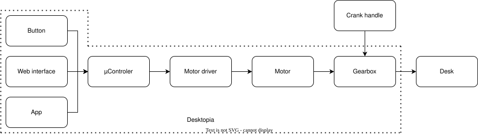
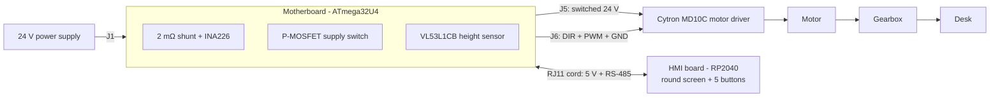

# Desktopia

Desktopia is an open-source project for easy height control of your IKEA Skarsta/Trotten sit-stand desk, providing a
comfortable and customizable workspace experience.

A DC motor replaces the crank handle. Two boards control it: the **motherboard** under the desk top, and the **HMI board**
on the front edge with a round screen and five buttons. A time-of-flight sensor measures the desk height, so the desk can
go back to three saved heights at the press of a button.

## How it works

- The **motherboard** makes every decision. It reads the height (VL53L1CB), runs the state machine, drives the motor
  driver (direction + PWM, with ramps) and stores the presets in its EEPROM. It also switches the driver's 24 V supply:
  on for a move, off after 5 minutes without one, and off at once if the motor current goes over the limit (INA226).
- The **HMI board** only displays what the motherboard sends and reports the button levels. It is powered by the
  motherboard through the RJ11 cord, which also carries the RS-485 link (250 kbaud, polled every 10 ms).
- If the cord, the sensor or the firmware fails, or the motor draws too much current, the motor stops: see the protections in
  [firmware/README.md](firmware/README.md#built-in-protections).

## Usage

| Action | Result |
|---|---|
| **Up / Down** held | the desk moves as long as the button is held |
| **Preset 1-3**, short press | the desk goes to the saved height |
| **Preset 1-3**, long press (2 s) | the current height is saved |
| any button during an automatic move | stop |

## Repository layout

| Folder | Content | Documentation |
|---|---|---|
| [hardware/desktopia/](hardware/desktopia/) | motherboard KiCad project (schematic, PCB) | [README](hardware/desktopia/README.md) |
| [hardware/desktopia_HMI/](hardware/desktopia_HMI/) | HMI board KiCad project (schematic, PCB) | [README](hardware/desktopia_HMI/README.md) |
| [hardware/kicad_library/](hardware/kicad_library/) | symbols and footprints shared by both KiCad projects (`JLCImport`, ...) | |
| [hardware/render.sh](hardware/render.sh) | renders the schematic / PCB / 3D images of the board READMEs; run by the [*Hardware images*](.github/workflows/hardware-images.yml) workflow on every push | |
| [firmware/](firmware/) | motherboard firmware (ATmega32U4, PlatformIO) and the PC simulation of both boards | [README](firmware/README.md) |
| [hmi_firmware/](hmi_firmware/) | HMI board firmware (RP2040, PlatformIO) | [README](hmi_firmware/README.md) |
| [shared/hmi_link/](shared/hmi_link/) | link protocol and screen model, compiled into both firmwares | [hmi_protocol.h](shared/hmi_link/hmi_protocol.h) |
| [documentation/](documentation/) | architecture drawing, VL53L1X datasheet | |

## Getting started

Tools: [KiCad 10](https://www.kicad.org/) for the boards, [PlatformIO](https://platformio.org/) for the firmwares.

1. **Boards**: open each KiCad project, update the PCB from the schematic and order it. Every assembled part has its
   JLCPCB / LCSC number in the `LCSC` field. Read the board READMEs first: both PCBs still have to be updated after
   the latest schematic changes.
2. **HMI firmware**: `cd hmi_firmware && pio run -t upload` with the board in USB boot mode.
3. **Motherboard firmware**: `cd firmware && pio run -t upload` (the board must be powered from its 24 V input).
4. **First power-up**: follow [the checklist](firmware/README.md#first-power-up-do-it-in-this-order), with the motor
   decoupled from the desk at first.

The firmware of both boards can be tested on a PC without any hardware (`firmware/sim/`, Linux / WSL).

## Status

- Firmwares: build with no warnings; tested in the PC simulation only.
- Schematics: ERC checked, netlists checked by script.
- PCBs: **not yet updated** to the latest schematics (RJ11 link, RP2040 HMI board, power input, current sensor, motor supply switch).
- Nothing has been tested on real boards yet.
