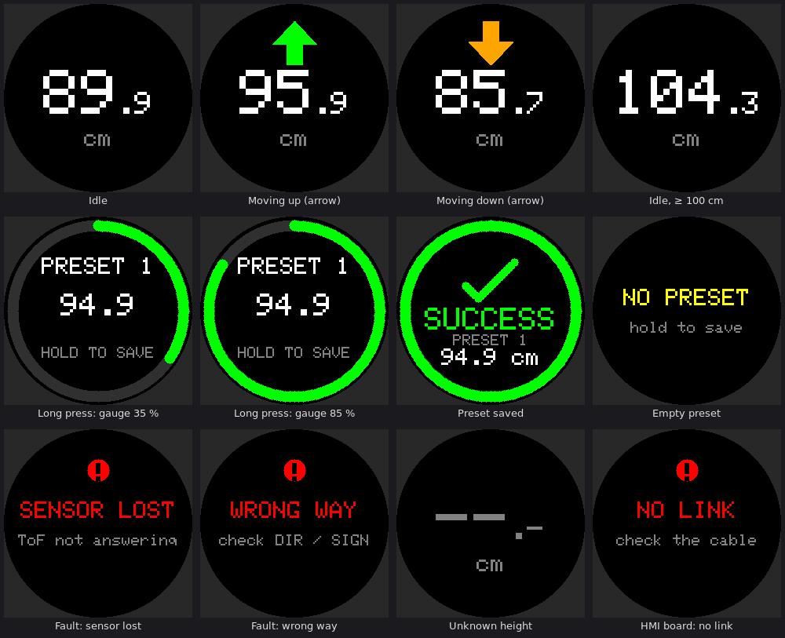

# Desktopia – firmware du standing desk

Firmware de la carte « Desktopia – motherboard » : ATmega32U4 (16 MHz, 5 V), framework Arduino, PlatformIO.
Pilote un moteur (DIR + PWM), lit la hauteur avec un VL53L1CB, lit 5 boutons via un TCA9554 et affiche
l'état sur un écran rond GC9A01.



*(Aperçu produit par le vrai code d'affichage, rendu pixel par pixel par l'émulateur de `sim/`.)*

## Fonctionnement

| Action | Résultat |
|---|---|
| **Up / Down** maintenu | le bureau bouge tant que le bouton est tenu ; démarrage en rampe (*soft start*), flèche verte / orange à l'écran |
| **Preset 1-3, appui court** (< 400 ms) | le bureau rejoint la hauteur enregistrée, en ralentissant progressivement sur les 80 derniers mm |
| **Preset 1-3, appui long** | au bout de 400 ms une jauge circulaire se remplit ; à 2 s : enregistrement en EEPROM puis écran *SUCCESS* |
| relâcher avant la fin de la jauge | rien n'est enregistré, rien ne bouge |
| un bouton pendant un déplacement automatique | arrêt (rampe de 300 ms), l'appui est ignoré jusqu'au relâchement |
| Up + Down ensemble | rien ne bouge tant que les deux ne sont pas relâchés |

PWM plafonné à **60 %**, direction **1 = monte / 0 = descend** (à changer dans `config.h`).

## Arborescence

```
include/board_pins.h     brochage extrait du schéma (numéros Arduino du variant « leonardo »)
include/config.h         TOUS les réglages, surchargeables avec -DNOM=valeur dans platformio.ini
src/main.cpp             setup() / loop()
src/io_expander.*        driver TCA9554
src/buttons.*            anti-rebond + appui court / long
src/tof_sensor.*         VL53L1CB via le driver ST (lib STM32duino VL53L1X) + filtre médian
src/motor.*              DIR + PWM Timer1, soft start / soft stop, protection du changement de sens
src/presets.*            EEPROM interne (magic + version + CRC-8)
src/gc9a01.*             driver d'écran compact (init reprise de la lib Adafruit, police 5×7)
src/display.*            interface (hauteur, flèche, jauge, messages) – ne redessine que ce qui change
src/desk_controller.*    machine à états, profil de vitesse, sécurités
src/watchdog.*           watchdog matériel : l'interruption coupe le PWM, le reset suit
src/ui_model.h           ce que le contrôleur transmet à l'écran
sim/                     banc de simulation sur PC (optionnel, voir plus bas)
```

## Brochage (extrait de `desktopia.kicad_sch`)

| Fonction | Net du schéma | MCU | Arduino |
|---|---|---|---|
| Moteur DIR | `Mdir` (J5-1) | PC6 | D5 |
| Moteur PWM | `Mpwm` (J5-2) | PB6 / OC1B | D10 |
| Écran CS / DC / RST | `CS_MBside` / `DC_MBside` / `RST_MBside` | PB0 / PB4 / PB5 | D17 / D8 / D9 |
| Écran SCK / MOSI | `SCK` / `MOSI` | PB1 / PB2 | SPI matériel |
| I2C SDA / SCL | `SDA` / `SCL` | PD1 / PD0 | Wire |
| TCA9554 /INT | `HMI_INT` | PE6 | D7 (pull-up interne, non utilisée) |
| ToF GPIO1 | `GPIO1_VL53` | PD2 | D0 (non utilisée) |
| Courant moteur | `Imotor` | PF0 | ignoré (capteur non monté) |

I2C : TCA9554 en `0x20` (A0-A2 à la masse), VL53L1CB en `0x29` (`0x52` en notation 8 bits).
Boutons : SW1…SW5 = P0…P4 du TCA9554, **actifs à l'état haut** (contact vers +5VA, pull-down 10 kΩ côté carte mère).
Affectation par défaut : SW1 = Up, SW2 = Down, SW3-SW5 = Preset 1-3 (`BTN_BIT_*` dans `config.h`).

## Compiler et flasher

```bash
pio run                                   # compile (env desktopia)
pio run -t upload                         # USB, bootloader Caterina (double appui sur RESET si le port n'apparaît pas)
pio run -e desktopia_debug -t upload      # idem + logs sur le port série USB (115200 bauds, émission seule)
pio device monitor
pio run -e desktopia_isp -t bootloader    # puce vierge : grave bootloader + fuses via J2 (USBasp)
```

L'environnement `desktopia_isp` (programmateur USBasp sur J2) sert au premier flash et au dépannage ; si le bootloader a disparu, le regraver avec `-t bootloader`.

Seule dépendance externe : le driver ST (`stm32duino/VL53L1X` 2.0.1, ULD), épinglé sur son tag dans `platformio.ini`.
Taille : ≈ 23,3 Ko de flash (≈ 81 % des 28 Ko disponibles à côté du bootloader), ≈ 0,75 Ko de RAM.

## Réglages principaux (`include/config.h`)

| Paramètre | Défaut | Rôle |
|---|---|---|
| `MOTOR_DIR_UP_LEVEL` / `MOTOR_DIR_DOWN_LEVEL` | HIGH / LOW | niveau de DIR pour monter / descendre |
| `MOTOR_PWM_MAX_PERCENT` | 60 | plafond absolu du rapport cyclique |
| `MOTOR_PWM_MIN_PERCENT` | 20 | plus petit PWM qui fait encore avancer le bureau (fin d'approche) – **à régler** |
| `MOTOR_PWM_FREQ_HZ` | 20000 | fréquence PWM (baisser à 1-4 kHz si le driver ne suit pas) |
| `MOTOR_SOFT_START_MS` / `MOTOR_SOFT_STOP_MS` | 1500 / 300 | rampes 0→max et max→0 |
| `APPROACH_DISTANCE_MM` / `TARGET_TOLERANCE_MM` | 80 / 2 | début du ralentissement / arrêt à ± |
| `TOF_HEIGHT_SIGN` / `TOF_HEIGHT_OFFSET_MM` | +1 / 0 | hauteur = OFFSET + SIGN × distance mesurée |
| `HEIGHT_MIN_MM` / `HEIGHT_MAX_MM` | 700 / 1200 | butées logicielles : **à mettre à l'intérieur de la course réelle** |
| `PRESET_SHORT_PRESS_MAX_MS` / `PRESET_LONG_PRESS_MS` | 400 / 2000 | seuils des appuis |
| `DISPLAY_ROTATION` | 1 | orientation de l'écran (0-3) |

## Première mise en service (à faire dans l'ordre)

1. **Moteur désaccouplé** de la mécanique (ou manivelle débrayée). Premier flash avec un PWM réduit :
   `build_flags = -DMOTOR_PWM_MAX_PERCENT=25` dans l'environnement utilisé.
2. L'écran doit afficher une hauteur plausible qui varie quand on déplace une cible devant le capteur.
   Sinon : `---` = capteur muet (voir *Points matériel*), valeur absurde = ajuster `TOF_HEIGHT_OFFSET_MM`.
3. Appui sur **Up** : le moteur doit tourner dans le sens « monter » **et** la hauteur affichée doit augmenter.
   Un désaccord est détecté après 15 mm de course : écran **WRONG WAY**. Corriger alors
   `MOTOR_DIR_UP_LEVEL`/`MOTOR_DIR_DOWN_LEVEL` (moteur à l'envers) ou `TOF_HEIGHT_SIGN` (hauteur à l'envers).
4. Régler `HEIGHT_MIN_MM` / `HEIGHT_MAX_MM` **à l'intérieur** des butées mécaniques (le firmware ralentit avant elles).
5. Remettre `MOTOR_PWM_MAX_PERCENT` à 60, accoupler la mécanique. Si **STALLED** apparaît en fin d'approche d'un preset,
   le PWM minimum est trop faible pour mettre le bureau en mouvement : augmenter `MOTOR_PWM_MIN_PERCENT` de 3-5 points.
6. Tester l'enregistrement d'un preset (appui long) puis son rappel depuis une autre hauteur, dans les deux sens.

## Protections intégrées

Pas de mesure de courant sur cette carte : tout repose sur le ToF.

- Perte du ToF (aucune mesure valide pendant 400 ms) ou du TCA9554 (boutons illisibles) → arrêt immédiat, sans rampe.
- Mauvais sens (15 mm dans le sens opposé), blocage (3 mm de progression en 1,5 s alors que le PWM dépasse le minimum),
  mouvement de plus de 60 s → arrêt immédiat et écran de défaut ; retour à l'état normal après 2,5 s si la cause a disparu.
- Butées logicielles `HEIGHT_MIN/MAX_MM` avec ralentissement ; un bouton maintenu à la butée ne redémarre pas.
- Le sens (DIR) ne change que lorsque le PWM est à 0, après 400 ms d'arrêt.
- Watchdog 500 ms : si la boucle se fige, une interruption coupe le PWM, puis le MCU redémarre.
  Il se met de côté quand le core Arduino reprogramme le watchdog pour le reset automatique vers le bootloader (upload USB).
- Bus I2C avec timeout (25 ms). Le driver ST boucle indéfiniment sur un NACK : il n'est appelé qu'après un ping d'adresse réussi.
- Aucune détection de pincement ou d'obstacle autre que le blocage « plus de progression ».

## Points matériel relevés sur le schéma

1. **`Mpwm` et `Mdir` n'ont pas de pull-down.** Pendant un reset, le bootloader ou un flash ISP, ces lignes flottent : selon le
   driver moteur, le bureau peut démarrer. Ajouter un pull-down (10 kΩ) sur `Mpwm` (et `Mdir`), ou vérifier que le driver en a un.
2. `HMI_INT` (sortie open-drain du TCA9554) n'a pas de pull-up : le firmware active celle du MCU, la ligne n'est pas exploitée
   (scrutation toutes les 5 ms).
3. PB0 est le CS de l'écran **et** la LED RX du core Leonardo : ne jamais lire le port série USB (`Serial.read()`), le core
   ferait osciller le CS. Les logs (`desktopia_debug`) n'utilisent que l'émission.
4. L'écran reçoit directement les signaux 5 V du MCU (pas de translation de niveau ni de résistances série) : vérifier dans la fiche
   du module qu'il accepte une logique 5 V.

## Hypothèses à confirmer

- L'écran est un **GC9A01 240×240** (connecteur 7 broches : VCC, GND, SCK, MOSI, DC, CS, RST). Sinon, seul `gc9a01.cpp` change.
- Le capteur est un **VL53L1CB** (et non « VL51 ») : ST le décrit comme un sur-ensemble du VL53L1X et le driver ULD est utilisé tel quel.
  L'identifiant lu au démarrage n'est pas imposé (il est affiché en mode debug) : à confirmer sur la carte.
- Hauteur et butées exprimées dans la grandeur que mesure ton montage (sens et décalage réglables, voir plus haut).

## Ce qui a été vérifié, et ce qui ne l'a pas été

- **Compilation AVR** avec avr-gcc 7.3.0 (la version embarquée par PlatformIO) et le core Arduino AVR 1.8.6, `-Wall -Wextra` sans avertissement.
- **Simulation sur PC** (`sim/run.sh`, 407 contrôles réussis) des vraies sources contre un bureau simulé, un ToF bruité
  (valeurs aberrantes et invalides comprises), un TCA9554 simulé avec rebonds et un écran GC9A01 émulé : rampes et plafond du PWM,
  sens de DIR, presets (appui court / long, EEPROM, jauge), précision du rappel (écart-type ≈ 2,4 mm avec un bruit capteur de 1-3 mm),
  butées, défauts, passage de `millis()` par zéro, rendu de l'écran.
- **Non testé** : sur la carte réelle. Aucun essai avec le driver moteur, le VL53L1CB, le module d'écran. PlatformIO lui-même n'a
  pas pu être exécuté dans l'environnement de travail (téléchargement des toolchains impossible) : son fichier `platformio.ini` a été
  validé par son analyseur et le code compilé avec le même GCC 7.3.0 et le core Arduino AVR 1.8.6.

## Banc de simulation (optionnel)

```bash
cd sim && ./run.sh     # Linux / WSL, g++ ; écrit des captures d'écran émulées dans sim/shots/ (PPM)
```
