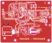
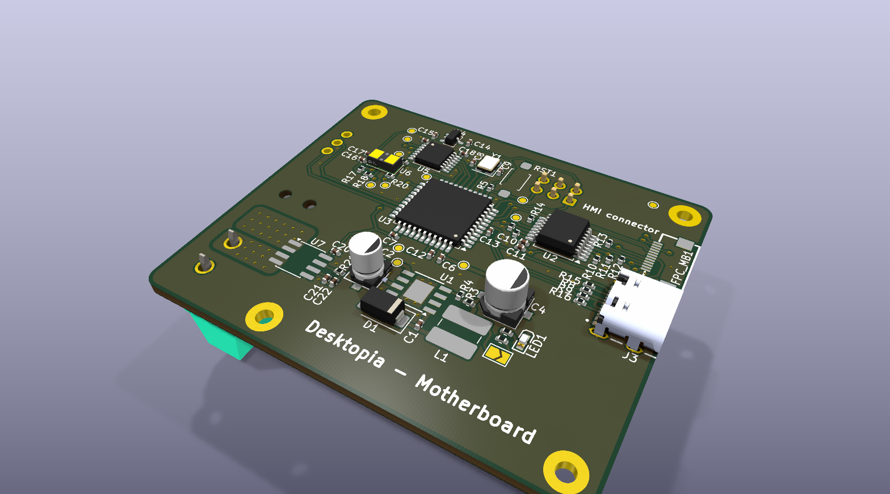
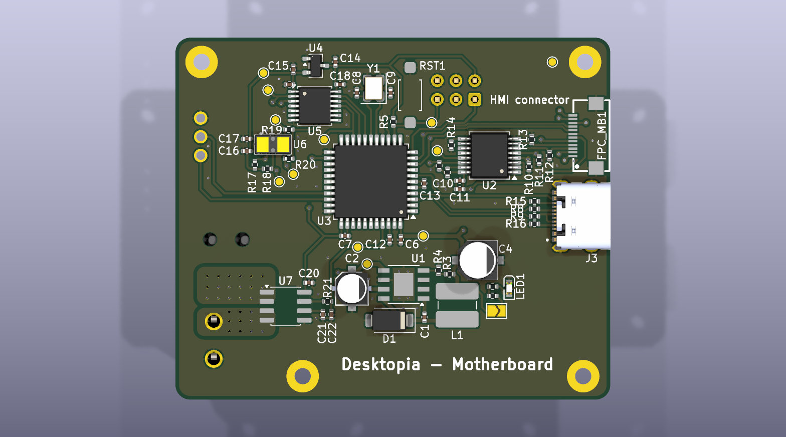
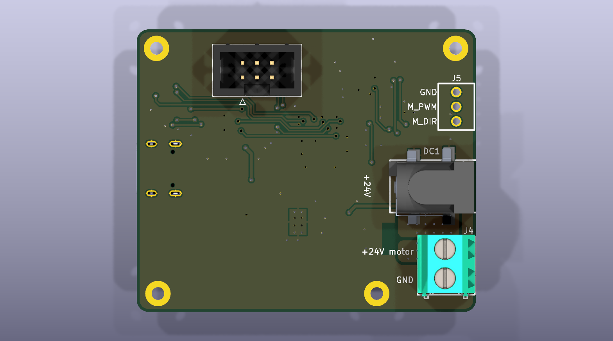

# Desktopia – motherboard

KiCad 10 project: `desktopia.kicad_sch`, `desktopia.kicad_pcb`. Firmware: [../../firmware/](../../firmware/README.md).

The motherboard sits under the desk top. It takes the 24 V supply and passes it to the motor driver through a current
shunt and a MOSFET switch. It measures the height and controls the motor driver. It also powers the HMI board and talks
to it.

## Views

Interactive viewer (KiCanvas, opens the files of the `main` branch in the browser):
[schematic](https://kicanvas.org/?github=https://github.com/Diabltica/Desktopia/blob/main/hardware/desktopia/desktopia.kicad_sch) · [PCB](https://kicanvas.org/?github=https://github.com/Diabltica/Desktopia/blob/main/hardware/desktopia/desktopia.kicad_pcb).

The images below are rendered by [`../render.sh`](../render.sh) and committed by the
[*Hardware images*](../../.github/workflows/hardware-images.yml) workflow on every push that touches `hardware/`.
Click an image to open it full size.

Reading the schematic: connections are drawn as wires. A label only appears where a net leaves one block for another,
at the MCU pin and at the block it reaches (`TOF_INT`, `SCL`, `SDA`, `Mpwm`, `Mdir`, `MOTOR_PWR`, `I_ALERT`, `RESET`,
`+5V_HMI`). Two labels only name a net: `MOTOR_24V` and `MOTOR_SW`, the 15 A nets. Wires that cross without a dot are
not connected: MISO over SCK / MOSI at J2, D+ over D- at the USB connector, Vin+ over Vin- at the INA226, DI over DE
at U5.

**Schematic**

**PCB**

| Front | Back (mirrored) |
|---|---|
|  |  |

**3D**

| Top | Bottom |
|---|---|
|  |  |

## Blocks

| Block | Parts | Notes |
|---|---|---|
| 24 V input | J1 (5.08 mm screw terminal, 24 A), D2 SMBJ28A (600 W TVS), C6 (100 µF 50 V bulk), C5 (10 µF 50 V ceramic), TP5 | J1 carries the full motor current. D2 clamps motor and hot-plug spikes below the 40 V absolute maximum of U2 and U6 |
| 24 V → 5 V | U2 TPS5430 (3 A buck), L1 22 µH (1.8 A, shielded), D1 SS34 (3 A), C3 10 nF (boot), C7 + C8 (2 × 47 µF ceramic), R4 / R7 (10k / 3.3k → 4.92 V), C4 / R9 / C12 / C11 (compensation) | 1.5 A available. ENA left open, see *Known issues* |
| Motor current | R23 2 mΩ 3 W shunt, U6 INA226 (I2C 0x40), C22, R25, C23 | ±41 A full scale; alert on PE6 / INT6 (R25 4.7k pull-up, C23 100 pF against motor spikes). The firmware cuts the PWM and Q5 on an alert |
| Motor supply switch | Q5 IPD90P04P4-05 (P-MOSFET, −40 V, 4.7 mΩ, TO-252), Q4 BSS138 (gate driver), R21 / R20 100k (gate divider), R22 10k (pull-down), D3 BZT52C15 (VGS clamp), C21 100 nF 50 V (soft start), D4 SS34, TP13 | no relay. `MOTOR_PWR` (PD7) high → Q4 on → VGS −12 V → J5 powered. R22 keeps it off while the MCU is in reset or blank. See *Power* |
| MCU | U4 ATmega32U4 @ 16 MHz (Y1, C15 / C16), RST1 reset button, R12 reset pull-up | Caterina bootloader, USB. HWB (PE2) is not connected: the Leonardo fuses leave HWBE off |
| USB | J3 USB-C (G-Switch GT-USB-7010ASV), R13 / R15 22 Ω, R18 / R19 5.1k on CC | VBUS only goes to the MCU's VBUS sense pin: USB does **not** power the board |
| ISP | J2 2×3 header (not assembled) | blank chip: bootloader + fuses with a USBasp |
| Height sensor | U3 VL53L1CB, U1 XC6206P282 (2.8 V LDO), Q1 / Q2 / Q3 BSS138 (5 V ↔ 2.8 V level shifters: SCL, SDA, GPIO1), R2 / R6 / R8 / R11, R10 | XSHUT tied high (R8). GPIO1 (data ready) reaches PB4 / PCINT4 as `TOF_INT` |
| Motor driver | J5 (switched 24 V out to the driver, `MOTOR_SW`), J6 (DIR, PWM, GND), R26 / R24 (10k pull-downs on PWM / DIR) | external Cytron MD10C R3. The pull-downs keep the motor stopped while the MCU is in reset, in the bootloader or blank |
| HMI link | J4 RJ11 6P6C, U5 SP485EEN (RS-485), F1 500 mA PTC, R14 / R17 4.7k bias, R16 120 Ω (not assembled), C18 / C20 | see the link section of the firmware README |
| Power LED | LED1, R3 (470 Ω, 6 mA), JP1 solder jumper | LED off until JP1 is bridged |

## Connectors

| Ref | Function | Pin-out |
|---|---|---|
| J1 | 24 V supply input | 1 = +24 V, 2 = GND |
| J2 | ISP | 1 = MISO, 2 = +5 V, 3 = SCK, 4 = MOSI, 5 = RESET, 6 = GND |
| J3 | USB-C: flashing and debug logs | USB 2.0 full speed |
| J4 | RJ11 cord to the HMI board | 1 = +5 V, 2 = GND, 3 = A, 4 = B, 5 = GND, 6 = +5 V |
| J5 | supply out to the motor driver (after the shunt and Q5) | 1 = MOTOR_SW, 2 = GND |
| J6 | motor driver command | 1 = DIR (`Mdir`, PC6), 2 = PWM (`Mpwm`, PB6 / OC1B), 3 = GND (the driver's logic ground) |

The J4 pin-out is symmetric, so a reversed telephone cord only swaps A and B, never +5 V and GND. The HMI firmware
detects and corrects the swap. Use 6-conductor (6P6C) cords only, and never plug J4 into a telephone wall socket.

J1 and J5 are the same terminal (KF128-5.08-2P, 24 A, 12-22 AWG), so they count as one Extended part. J6 is a 3-pin
2.54 mm terminal (ZX-DG28L-2.54-3P, 18-26 AWG) for the thin command wires. The MD10C joins its logic and power grounds,
so the ground wire of J6 runs in parallel with the one of J5. It carries a share of the motor current, set by the ratio
of the wire resistances: about 10 %, so 1 A at 10 A, with 24 AWG on J6 and 14 AWG on J5 of the same length. The wire
handles that easily. On the PCB, this current flows from J6 pin 3 to J5 pin 2 (see *PCB: what to do before ordering*).

## Power

- Input: 24 V, 28 V at most (D2 starts to conduct at 31.1 V; the MD10C itself is limited to 30 V). Size the supply
  for the motor (the MD10C is rated 13 A continuous) plus a few watts for the electronics.
- Motor path, sized with margin: J1 / J5 terminals 24 A, R23 3 W (0.34 W at 13 A, 1.8 W at the MD10C's 30 A peak),
  Q5 90 A (0.8 W at 13 A, 0.12 W at 5 A), C6 100 µF 50 V bulk, D2 600 W TVS. Give J1 → R23 → Q5 → J5 and the ground
  return copper for 15 A or more.
- C6 damps the supply cable: plugged in live, the cable inductance and the ceramic C5 ring up to about twice the
  input, 40 V or more, which is the absolute maximum of U2 and U6. What damps it is the ESR of an aluminium
  electrolytic (0.3 to 1 Ω), more than its capacitance. A simulation with a 0.7 to 3 µH cable gives a peak of 24 to
  28 V with C6 (ESR about 0.6 Ω), and 38 to 43 V with ceramics only. So C6 cannot be replaced by ceramics, nor by a
  polymer or hybrid capacitor, whose ESR is too low.
- Motor supply switch (Q5, high side, no relay): the firmware switches the driver on for a move and off after 5 minutes
  without one, or at once on an INA226 alert. R21 / R20 split the 24 V, so Q5 sees VGS = −12 V; D3 clamps
  it at 15 V, under the ±20 V maximum, even with a 28 V input. C21 (gate-drain) makes Q5 turn on in about 15 ms, so the
  driver's input capacitors charge without an inrush spike; the firmware waits 100 ms before the first PWM. Turning off
  takes about 20 ms (R21 alone discharges the gate). The firmware only does it with the PWM at 0, so Q5 never opens
  under load. On an overcurrent, the PWM cut is what stops the current, and Q5 then isolates the driver. **Q5 is not a
  fuse**: if the driver itself fails short, Q5 opens too slowly to protect it. Keep a fuse (15 A) in the 24 V supply
  cable. D4 clamps J5 when the driver's cable inductance pulls MOTOR_SW below ground at turn-off. The P-MOSFET's body
  diode lets the motor's braking energy flow back to C6 when Q5 is off.
- 5 V rail (TPS5430): MCU, transceiver, INA226, and the HMI board through F1 (500 mA PTC). L1 (1.8 A saturation) and
  D1 (3 A) allow 1.5 A, about twice the worst case (HMI at the PTC limit + this board).
- The 5 V output uses ceramic capacitors, so the TPS5430 needs the external compensation of TI's SLVA237 (C4, R9, C12,
  C11). A model of the loop (TPS5430 type III network + LC filter + this network) gives a 14 to 27 kHz crossover and
  more than 60° of phase margin from 0.1 to 1.5 A, with ±25 % on the output capacitance.
- 2.8 V rail (XC6206P282, ±2 %): VL53L1CB, its pull-ups and the gates of Q1 / Q2. 2.8 V is the sensor's typical
  supply (recommended 2.6 to 3.5 V, 3.6 V absolute maximum, datasheet DS12385). That leaves 0.7 V of headroom under the
  maximum; 3.3 V would only leave 0.13 V in the worst case.

## I2C bus

| Device | Address | Side |
|---|---|---|
| INA226 (U6) | 0x40 (A0 = A1 = GND) | 5 V |
| VL53L1CB (U3) | 0x29 (0x52 in 8-bit form) | 2.8 V, behind Q1 / Q2 |

SDA = PD1, SCL = PD0. Pull-ups: 3.3k R1 (SCL) / R5 (SDA) to 5 V, and R2 / R6 to 2.8 V on the sensor side of Q1 / Q2.
Q1 / Q2 are the classic MOSFET level shifter (NXP AN10441): gate on +2V8, source on the sensor side, drain on the 5 V
side. The BSS138 (Vgs(th) 1.5 V max) turns fully on with 2.8 V on its gate, so a low from the MCU reaches the sensor at
about 0.2 V, under its 0.6 V VIL. A 2N7002 (Vgs(th) up to 2.5 V) would only pass it through its body diode, around 0.8 V.
At 400 kHz the 3.3k pull-ups give about 220 ns of rise time, under the 300 ns of the fast-mode specification (ST
suggests 3.6k up to 90 pF).

Q3 is the same circuit on the VL53L1CB GPIO1 (data-ready interrupt, R11 10k pull-up to 2.8 V). It gives `TOF_INT` on
PB4 (D8, pin-change interrupt PCINT4), with R10 10k pull-up to 5 V. The MCU sees a full 5 V high level instead of
2.8 V, which is under the ~3 V input threshold of the ATmega. The firmware polls the sensor over I2C and does not use
`TOF_INT` yet.

The ATmega32U4 has five external interrupts, all taken. INT0 / INT1 (PD0 / PD1) are the I2C and INT2 / INT3
(PD2 / PD3) the RS-485 UART; both are fixed by the hardware. INT6 (PE6) is kept for the INA226 alert (`I_ALERT`).
`TOF_INT` therefore uses a pin-change interrupt. It is also a hardware interrupt, with the same latency, but
`attachInterrupt()` does not cover it: configure PCICR / PCMSK0, or simply read PB4. PB0, PB5 and PB7 are free and
keep their pin-change interrupts (PCINT0 / 5 / 7).
The INA226 settings are Rshunt = 2 mΩ, current LSB = 1.25 mA, calibration = 2048. It reads 0.34 W in the
shunt at 13 A.

## Test points

| TP | Net | TP | Net |
|---|---|---|---|
| TP1 | +5V | TP8 | VL53L1CB XSHUT |
| TP2 | +2V8 | TP9 | `TOF_INT` (5 V side) |
| TP3 | SCL (5 V side) | TP10 | GPIO1 on the 2.8 V side |
| TP4 | SCL on the 2.8 V side | TP11 | RESET |
| TP5 | +24V | TP12 | GND |
| TP6 | SDA (5 V side) | TP13 | MOTOR_SW (driver supply, after Q5) |
| TP7 | SDA on the 2.8 V side | | |

## Assembly (JLCPCB)

Every assembled part has its LCSC number in the `LCSC` and `jlcpcb PartNumber` fields. JLCPCB charges a loading fee
(about $3 per order) for each Extended part number. Basic parts have none, and Preferred parts have none in Economic
PCBA.

- Extended: C6 (100 µF bulk), L1, F1, J3 (USB-C), J1 / J5 (one part number), J4, J6, Q5 (motor supply switch), R23,
  U1 (2.8 V LDO), U3 (VL53L1CB), U6 (INA226). JLCPCB has no Basic power inductor, electrolytic capacitor, fuse,
  connector, shunt, 2.8 V regulator or power P-MOSFET. Q5 (IPD90P04P4-05, C536914) cost $1.94 with 469 in stock in
  October 2026: check the stock before ordering. Any −40 V P-MOSFET in TO-252 with RDS(on) ≤ 10 mΩ at
  −10 V fits the footprint.
- Preferred: D2 (TVS), D3 (Zener), Q1 / Q2 / Q3 / Q4 (BSS138). Everything else is Basic.
- Not in the BOM: U4 (the ATmega32U4 has *Exclude from BOM* set: solder it yourself or clear the flag), J2 (ISP
  header), R16 (termination), the test points and the mounting holes H1-H3 (M2).

The October 2026 cost pass went from 12 Extended part numbers to 9 (J3 aside), about $9 less of loading fees per
order:

- The TXS0104E level shifter → Q1 / Q2 BSS138 (Preferred). Its two decoupling capacitors are gone.
- The 33 µF electrolytic on the 5 V output → C7 / C8, 2 × 47 µF ceramic (Basic), with the compensation network. C6
  stays the only electrolytic.
- The 3-pin 2.54 mm motor command terminal → the same 2-pin terminal as J1 / J5 (J6 got its 3 pins back later, see
  below).
- J3 GCT USB4105 (out of stock, about $1) → G-Switch GT-USB-7010ASV ($0.09, in stock), now in the BOM.
- Two LED resistors in series → R3 alone. F1 → a 30 V PTC with more stock.

Parts cost about $0.25 more per board. The motor input and the 5 V rail got more margin (TVS, 220 µF bulk, 24 A
terminals, 1.5 A rail). The motor command lines got pull-downs, the ToF interrupt a level shifter, and the INA226
alert a filter. U1 stays at 2.8 V for the sensor's headroom (see *Power*).

The motor supply switch came after the cost pass. It adds one Extended part (Q5, so 10 in all) and about $2 of parts per
board, Q5 being almost all of it. Then J6 got a ground pin, which brought back its 3-pin 2.54 mm terminal (C49023012):
one more Extended part (11 in all, about $3 more per order) and $0.11 per board. C6 then went from 220 µF in a
10 × 10 mm can (C2887271) to 100 µF in an 8 × 10 mm can (C970687, $0.08): 95 mm² of courtyard instead of 140 mm²,
with almost the same damping (see *Power*).

The schematic was then re-annotated: this README, the firmware README and the comments of the firmware use the new
references.

## PCB: what to do before ordering

The PCB matches the schematic, references included, except C6: run *Tools → Update PCB from Schematic* once more to
get its 8 × 10 mm footprint. The routing is not finished. For the layout:

- Place C5 right against VIN / GND of U2 (TI asks for a ceramic within 1 mm). Put D2 and C6 next to J1.
- Keep the buck loop tight: C7 / C8 next to L1 and the ground of D1. Put C4, C11, R9 and C12 next to the VSENSE pin
  of U2, away from the PH node and L1.
- J1 / J5 keep the `C508128L-2P0G36` footprint (5.08 mm, 1.7 mm holes), which fits the KF128-5.08 terminal.
  Check the body outline against its datasheet.
- Put J6 next to J5 and connect J6 pin 3 to J5 pin 2 through the ground pour by a short, wide path, away from the
  ground of the MCU and the sensor: part of the motor current returns that way.
- Give J1 → R23 → Q5 → J5 and the GND return copper for 15 A: pours, or tracks at least 5 mm wide in 1 oz copper.
  Give the drain tab of Q5 a few cm² of copper. Keep D4 between J5 pin 1 and its ground pin, and C21, D3, R21 close
  to Q5.
- Route Vin+ / Vin- of the INA226 as a Kelvin pair from the inner side of the R23 pads.
- Check the RJ11 jack J4 (EVERCOM 5301-6P6C, C3097716) against the Amphenol 54601 footprint it uses. Compare the
  drilling with the part's datasheet.

## Known issues and history

1. **TPS5430 ENA (fixed in the schematic).** ENA (pin 5) used to be tied to the 24 V input. Its absolute maximum
   is 7 V, and that burnt the regulator on the first board. ENA is now left open: its internal 1.5 MΩ pull-up keeps
   the regulator on. On a board that met this fault, also check the 5 V parts, since the dead regulator may have
   passed the 24 V through.
2. **Barrel jack (fixed).** The barrel jack was rated 1.5 A / 12 V and carried the motor current. It is replaced by
   the J1 screw terminal.
3. **`Mpwm` and `Mdir` pull-downs (fixed in the schematic).** These lines floated during a reset, the bootloader or an
   ISP flash, and the desk could start moving. R26 / R24 (10 kΩ) now hold them low.
4. **Current limit to tune.** The INA226 alert threshold (`MOTOR_CURRENT_LIMIT_MA` in the firmware, 8 A by default)
   is a guess. Measure the real supply current with the `desktopia_debug` build, which logs it during a loaded climb,
   then set the limit at about 1.5 × the peak.
5. The 5 V loop compensation (C4 / R9 / C12 / C11) is calculated, not measured. On the first board, check the 5 V
   ripple and a load step, for example 0.1 → 0.6 A.
6. **VL53L1CB I/O mode.** The ST driver (STM32duino VL53L1X 2.0.1) writes 0 to registers 0x2E / 0x2F, which selects the
   1V8 I/O mode. This board pulls SCL / SDA / GPIO1 up to AVDD (2.8 V), and for that the datasheet (DS12385, table 13)
   asks for the 2V8 mode: set bit 0 of 0x2E (I2C) and 0x2F (GPIO1) after `VL53L1X_SensorInit()`. The original design
   had the same mismatch.
