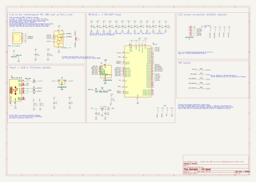
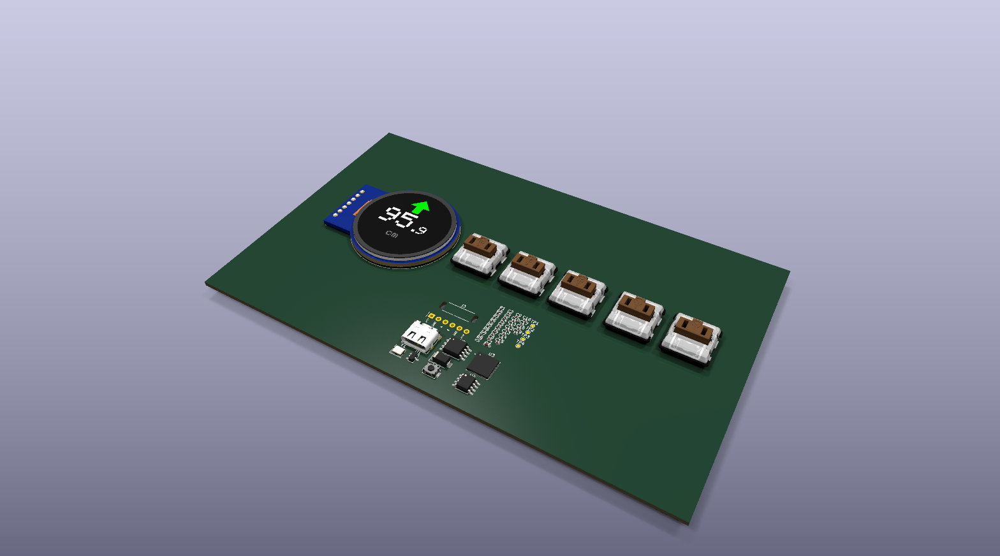
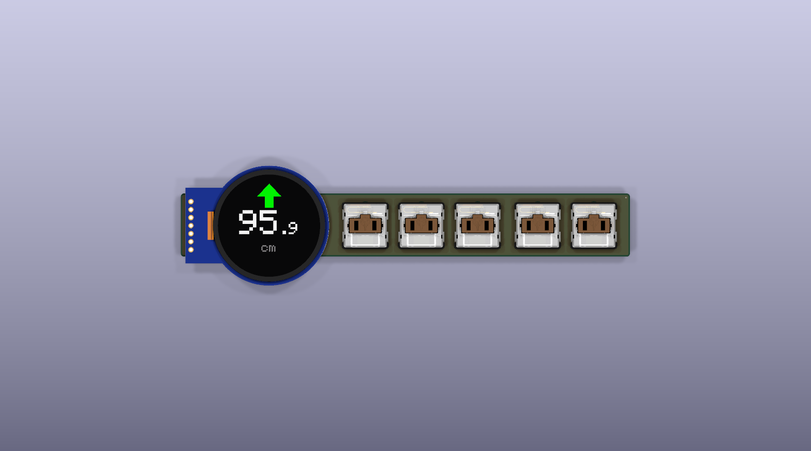
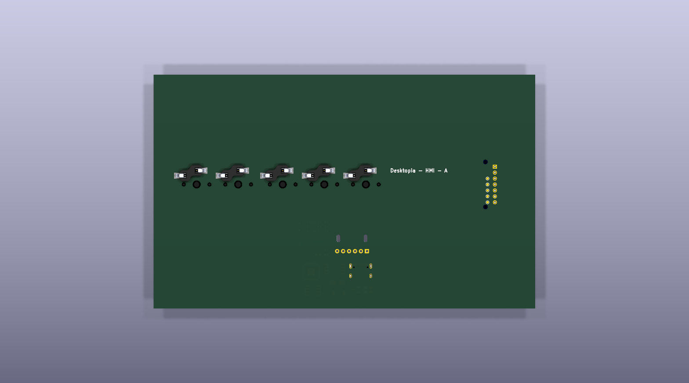

# Desktopia – HMI board

KiCad 10 project: `desktopia_HMI.kicad_sch`, `desktopia_HMI.kicad_pcb`. Firmware: [../../hmi_firmware/](../../hmi_firmware/README.md).

The HMI board sits on the front edge of the desk. It carries the round screen and the five buttons. Its own RP2040
draws the screen, debounces the buttons and answers the motherboard over RS-485. A single RJ11 cord brings both the
power and the link.

## Views

Interactive viewer (KiCanvas, opens the files of the `main` branch in the browser):
[schematic](https://kicanvas.org/?github=https://github.com/Diabltica/Desktopia/blob/main/hardware/desktopia_HMI/desktopia_HMI.kicad_sch) · [PCB](https://kicanvas.org/?github=https://github.com/Diabltica/Desktopia/blob/main/hardware/desktopia_HMI/desktopia_HMI.kicad_pcb).

The images below are rendered by [`../render.sh`](../render.sh) and committed by the
[*Hardware images*](../../.github/workflows/hardware-images.yml) workflow on every push that touches `hardware/`.
Click an image to open it full size.
The screen module model (`RoundLCD.wrl`) shows the real UI, taken from a screenshot of the simulator: it is generated by
[`round_lcd_3d.py`](../kicad_library/pcb/tools/round_lcd_3d.py) (rerun it after `firmware/sim/run.sh` to show another screen).

Reading the schematic: every connection is a wire, with no labels. The parts sit next to the RP2040 pins they use:
the flash, crystal, USB, RUN and SWD on its left; the RS-485 transceiver, the buttons and the screen connector on its
right. Wires that cross without a dot are not connected: GPIO0 (to DI) over GPIO1 / GPIO2, and the screen CS (GPIO17)
over SCK / MOSI / DC, because the connector pin order differs from the GPIO order.

**Schematic**

**PCB**

| Front | Back (mirrored) |
|---|---|
|  |  |

**3D**

| Top | Bottom |
|---|---|
|  |  |

## Blocks

| Block | Parts | Notes |
|---|---|---|
| MCU | U3 RP2040, Y1 12 MHz (C8 / C10 33 pF, R6 1k), decoupling C4-C7, C9, C11-C19 | standard Raspberry Pi minimal design |
| Flash | U2 W25Q128JVSIQ (16 MB QSPI) | the firmware uses 2 MB |
| 3.3 V | U1 XC6206P332 LDO, C1 / C2 (input), C3 (output) | supplies the RP2040, flash and transceiver |
| Link | J3 solder pads for the 6P6C cord, U4 SP3485EN (3.3 V RS-485), R8 120 Ω (not assembled) | UART0: GP0 TX, GP1 RX, GP2 DE + /RE |
| USB | J1 USB-C (G-Switch GT-USB-7010ASV), D1 SS14, R1 / R3 5.1k on CC, R4 / R2 22 Ω (D+ / D-) | bench flashing only |
| Boot / debug | SW1 BOOT (QSPI_SS through R5 1k), R7 10k RUN pull-up, TP1-TP4 SWD | no reset button: replug, or ground TP2 (RUN) |
| Screen | J2 7-pin connector, TP5-TP9 | GC9A01 240×240 round LCD on SPI0 |
| Buttons | SW2-SW6 Kailh Choc hot-swap sockets (PG1350) | to GND, internal pull-ups |

## Connectors

| Ref | Function | Pin-out |
|---|---|---|
| J1 | USB-C | flashing (UF2 bootloader) |
| J2 | round LCD | 1 = RST (GP21), 2 = CS (GP17), 3 = DC (GP20), 4 = MOSI (GP19), 5 = SCK (GP18), 6 = GND, 7 = +5 V |
| J3 | flat 6P6C cord to the motherboard, soldered (see below) | 1 = +5 V, 2 = GND, 3 = A, 4 = B, 5 = GND, 6 = +5 V |

J2 is numbered from the other end than the module's pin labels: the module's VCC, GND, SCL, SDA, DC, CS, RST are
J2 pins 7 down to 1.

Buttons: SW2 Up = GP11, SW3 Down = GP12, SW4-SW6 Preset 1-3 = GP13-GP15.

## The cord (J3)

The board sits at 45° under the front edge of the desk, in a wedge-shaped housing. An RJ11 jack would stand 12 mm
off the board, and its cord would leave parallel or perpendicular to the board, so at 45° to the desk either way.
The cord is therefore **soldered**: J3 (`Desktopia:Cable_6P6C_SolderPads`) has six 1 mm holes at 2.54 mm and two
slots for a 2.5 mm cable tie. The cord leaves over the board edge (the dashed *board edge* line on the Fab layer) and
folds flat against the underside of the desk. Only the motherboard end has an RJ11 plug, so the cord is unplugged there.

1. Take a flat 6-conductor cord (6P6C, sometimes sold as "RJ12") with a plug on one end, or crimp one.
   4-conductor cords (6P4C) do not work.
2. Strip about 10 mm of the jacket, strip and tin 3 mm of each wire.
3. Solder the wires **in their flat order**, edge wire on pad 1. Either direction is fine: the pin-out is symmetric, and
   a mirrored order only swaps A and B, which the firmware detects. Never cross two wires. The Fab layer shows the
   usual colours (white, black, red, green, yellow, blue), for reference only.
4. Put a cable tie through the two slots around the jacket, just behind the stripped end.

## Power

- The motherboard supplies 5 V through the cord, limited by its 500 mA PTC. The screen module takes the 5 V and
  regulates its own 3.3 V. Its logic is driven at 3.3 V by the RP2040.
- On the bench, USB-C powers the board through the Schottky D1, which keeps the cord's 5 V out of the USB host.
  Unplug the cord at the motherboard while flashing over USB: otherwise the USB also feeds the motherboard's 5 V rail through the cord.

## Flashing

First flash: hold **SW1 (BOOT)**, plug the USB-C cable, then release SW1. The board appears as a USB drive (RPI-RP2).
Then run `pio run -t upload`, or copy `firmware.uf2` onto the drive. Later updates work the same way, or through SWD
on TP4 (SWCLK) / TP3 (SWDIO) / TP1 (GND).

## Test points

| TP | Net | TP | Net |
|---|---|---|---|
| TP1 | GND | TP6 | LCD_MOSI |
| TP2 | RUN (ground it to reset) | TP7 | LCD_DC |
| TP3 | SWDIO | TP8 | LCD_CS |
| TP4 | SWCLK | TP9 | LCD_RST |
| TP5 | LCD_SCK | | |

## Assembly (JLCPCB)

Every assembled part has its LCSC number in the `LCSC` and `jlcpcb PartNumber` fields, Basic parts first.

- Y1 is the Basic X322512MSB4SI (C9002). It is specified for a 20 pF load, hence the 33 pF capacitors C8 / C10.
- The Kailh Choc hot-swap sockets (CPG135001S30, C5333465) are out of stock at JLCPCB: solder them by hand.
- J1 is the G-Switch GT-USB-7010ASV (C2988369, $0.09). It replaces the HRO TYPE-C-31-M-12 ($0.19); the pins are the
  same, the footprint is KiCad's `USB_C_Receptacle_G-Switch_GT-USB-7010ASV`.
- U2 stays the W25Q128JVSIQ (16 MB) because it is a Basic part. The 2 MB and 4 MB Winbond parts are Extended at JLCPCB
  and cost $1.0 to $1.4. With the $3 loading fee, they only pay off from about 4 boards per order.
- The other extended parts are U3 (RP2040) and J1. Everything else is Basic.
- Not assembled: R8 (termination, only for cords over ~5 m) and the test points. J2 takes the screen module's
  cable.
- 3D model of J1: the LCSC one (`kicad_library/pcb/JLCImport.3dshapes`), as on the motherboard. R8 has its model but
  is marked DNP, so the 3D view hides it.

## PCB: what to do before ordering

The PCB matches the schematic, references included (the schematic was re-annotated). The routing is not finished.

- Place J3 against the edge that faces the desk, with its dashed *board edge* line on the outline, so the cord leaves
  straight over the edge. Keep the area between the pads and the edge free of parts (cable tie, wires).
- Place the RP2040 decoupling capacitors next to each supply pin, keep a solid ground under the QFN, and keep the
  crystal and the QSPI flash close to the RP2040.
