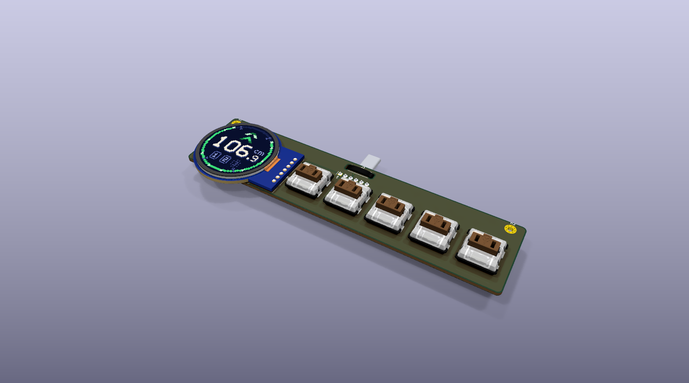
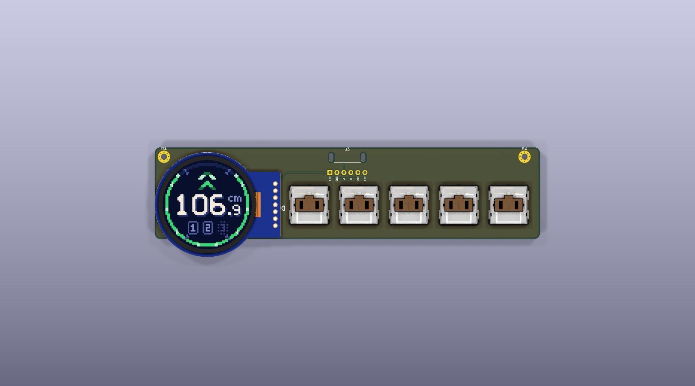
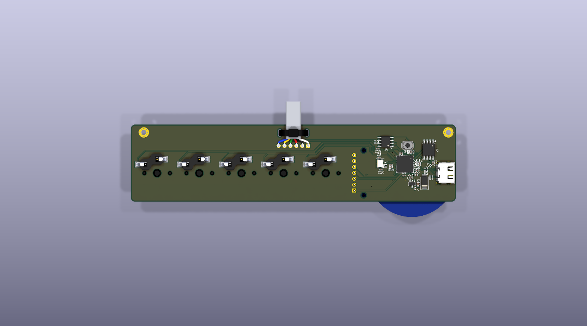

# Desktopia – HMI board

KiCad 10 project: `desktopia_HMI.kicad_sch`, `desktopia_HMI.kicad_pcb`. Firmware: [../../firmware/desktopia_HMI/](../../firmware/desktopia_HMI/README.md).

The HMI board sits on the front edge of the desk. It carries the round screen and the five buttons. Its own RP2040
draws the screen, debounces the buttons and answers the motherboard over RS-485. A single RJ11 cord brings both the
power and the link.

## Views

Interactive viewer (KiCanvas, opens the files of the `main` branch in the browser):
[schematic](https://kicanvas.org/?github=https://github.com/Diabltica/Desktopia/blob/main/hardware/desktopia_HMI/desktopia_HMI.kicad_sch) · [PCB](https://kicanvas.org/?github=https://github.com/Diabltica/Desktopia/blob/main/hardware/desktopia_HMI/desktopia_HMI.kicad_pcb).

The images below are rendered by [`../render.sh`](../render.sh) and committed by the
[*Hardware images*](../../.github/workflows/hardware-images.yml) workflow on every push that touches `hardware/`.
Click an image to open it full size.
The screen module model (`RoundLCD.wrl`) shows the real UI, taken from a screenshot of the simulator: it is generated by
[`round_lcd_3d.py`](../kicad_library/pcb/tools/round_lcd_3d.py) (rerun it after `firmware/sim/run.sh` to show another screen).
The picture is turned the way the firmware draws it for the module's position on the board (see J2 below).
The cord soldered to J3 (`Cable_6P6C_SolderPads.wrl`: about 1 cm of cord, the six wires, the solder joints and the
cable tie) is generated by [`cable_6p6c_3d.py`](../kicad_library/pcb/tools/cable_6p6c_3d.py).

Reading the schematic: every connection is a wire, with no labels. The parts sit next to the RP2040 pins they use:
the flash, crystal, USB, RUN and SWD on its left; the RS-485 transceiver, the buttons and the screen connector on its
right. Wires that cross without a dot are not connected: GPIO0 (to DI) over GPIO1 / GPIO2, and the screen CS (GPIO17)
over SCK / MOSI / DC, because the connector pin order differs from the GPIO order.
Each block has its own background and title colour (power and USB, RP2040 and flash, RS-485 link, buttons, screen).
Wires take the colour of their net class, as on the motherboard, with a legend at the bottom left of the sheet:
orange +5V, purple +3V3, pink +1V1, grey GND, teal the buses (USB, RS-485 and its UART, QSPI, screen SPI), green the
rest. See *PCB rules*.

**Schematic**

**PCB**

| Front | Back (mirrored) |
|---|---|
|  |  |

**3D**

| Top | Bottom |
|---|---|
|  |  |

## Blocks

| Block | Parts | Notes |
|---|---|---|
| MCU | U3 RP2040, Y1 12 MHz (C8 / C10 33 pF, R6 1k), decoupling C4-C7, C9, C11-C19 | standard Raspberry Pi minimal design |
| Flash | U2 W25Q128JVSIQ (16 MB QSPI) | the firmware uses 2 MB |
| 3.3 V | U1 XC6206P332 LDO, C1 / C2 (input), C3 (output) | supplies the RP2040, flash and transceiver |
| Link | J3 solder pads for the 6P6C cord, U4 SP3485EN (3.3 V RS-485), R8 120 Ω (not assembled) | UART0: GP0 TX, GP1 RX, GP2 DE + /RE |
| USB | J1 USB-C (G-Switch GT-USB-7010ASV), D1 SS14, R1 / R3 5.1k on CC, R4 / R2 22 Ω (D+ / D-) | bench flashing only |
| Boot / debug | SW1 BOOT (QSPI_SS through R5 1k), R7 10k RUN pull-up, TP1-TP4 SWD | no reset button: replug, or ground TP2 (RUN) |
| Screen | J2 7-pin connector, TP5-TP9 | GC9A01 240×240 round LCD on SPI0 |
| Buttons | SW2-SW6 Kailh Choc hot-swap sockets (PG1350) | to GND, internal pull-ups |

## Connectors

| Ref | Function | Pin-out |
|---|---|---|
| J1 | USB-C | flashing (UF2 bootloader) |
| J2 | round LCD | 1 = RST (GP21), 2 = CS (GP17), 3 = DC (GP20), 4 = MOSI (GP19), 5 = SCK (GP18), 6 = GND, 7 = +5 V |
| J3 | flat 6P6C cord to the motherboard, soldered (see below) | 1 = +5 V, 2 = GND, 3 = A, 4 = B, 5 = GND, 6 = +5 V |

J2 is numbered from the other end than the module's pin labels: the module's VCC, GND, SCL, SDA, DC, CS, RST are
J2 pins 7 down to 1.

The module sits with its pin header towards the buttons (J2 at 90°), turned 180° from the first layout: the firmware
turns the picture to match (`DISPLAY_ROTATION` 3 in `firmware/desktopia_HMI/include/hmi_config.h`).

Buttons: SW2 Up = GP11, SW3 Down = GP12, SW4-SW6 Preset 1-3 = GP13-GP15.

## The cord (J3)

The board sits at 45° under the front edge of the desk, in a wedge-shaped housing. An RJ11 jack would stand 12 mm
off the board, and its cord would leave parallel or perpendicular to the board, so at 45° to the desk either way.
The cord is therefore **soldered**: J3 (`Desktopia:Cable_6P6C_SolderPads`) has six 1 mm holes at 2.54 mm and two
slots for a 2.5 mm cable tie. The cord lies against the **bottom** of the board, leaves over the board edge (the
dashed *board edge* line on the Fab layer) and folds flat against the underside of the desk. Only the motherboard end
has an RJ11 plug, so the cord is unplugged there.

1. Take a flat 6-conductor cord (6P6C, sometimes sold as "RJ12") with a plug on one end, or crimp one.
   4-conductor cords (6P4C) do not work.
2. Strip about 10 mm of the jacket, strip and tin 3 mm of each wire.
3. Push the wires through the holes from the bottom and solder them on the top, **in their flat order**, edge wire
   on pad 1. Either direction is fine: the pin-out is symmetric, and
   a mirrored order only swaps A and B, which the firmware detects. Never cross two wires. The Fab layer shows the
   usual colours (white, black, red, green, yellow, blue), for reference only.
4. Put a cable tie through the two slots around the jacket, just behind the stripped end, its head under the cord.

## Power

- The motherboard supplies 5 V through the cord, limited by its 500 mA PTC. The screen module takes the 5 V and
  regulates its own 3.3 V. Its logic is driven at 3.3 V by the RP2040.
- On the bench, USB-C powers the board through the Schottky D1, which keeps the cord's 5 V out of the USB host.
  Unplug the cord at the motherboard while flashing over USB: otherwise the USB also feeds the motherboard's 5 V rail through the cord.

## Flashing

First flash: hold **SW1 (BOOT)**, plug the USB-C cable, then release SW1. The board appears as a USB drive (RPI-RP2).
Then run `pio run -t upload`, or copy `firmware.uf2` onto the drive. Later updates work the same way, or through SWD
on TP4 (SWCLK) / TP3 (SWDIO) / TP1 (GND).

## Test points

| TP | Net | TP | Net |
|---|---|---|---|
| TP1 | GND | TP6 | LCD_MOSI |
| TP2 | RUN (ground it to reset) | TP7 | LCD_DC |
| TP3 | SWDIO | TP8 | LCD_CS |
| TP4 | SWCLK | TP9 | LCD_RST |
| TP5 | LCD_SCK | | |

## Assembly (JLCPCB)

Every assembled part has its LCSC number in the `LCSC` and `jlcpcb PartNumber` fields, Basic parts first.

- Y1 is the Basic X322512MSB4SI (C9002). It is specified for a 20 pF load, hence the 33 pF capacitors C8 / C10.
- The Kailh Choc hot-swap sockets (CPG135001S30, C5333465) are out of stock at JLCPCB: solder them by hand.
- J1 is the G-Switch GT-USB-7010ASV (C2988369, $0.09). It replaces the HRO TYPE-C-31-M-12 ($0.19); the pins are the
  same, the footprint is KiCad's `USB_C_Receptacle_G-Switch_GT-USB-7010ASV`.
- U2 stays the W25Q128JVSIQ (16 MB) because it is a Basic part. The 2 MB and 4 MB Winbond parts are Extended at JLCPCB
  and cost $1.0 to $1.4. With the $3 loading fee, they only pay off from about 4 boards per order.
- The other extended parts are U3 (RP2040) and J1. Everything else is Basic.
- Not assembled: R8 (termination, only for cords over ~5 m) and the test points. J2 takes the screen module's
  cable.
- 3D model of J1: the LCSC one (`kicad_library/pcb/JLCImport.3dshapes`), as on the motherboard. R8 has its model but
  is marked DNP, so the 3D view hides it.

## PCB rules

The method and the sources are the motherboard's (see *PCB rules* in its [README](../desktopia/README.md)): 2 layers,
FR-4 1.6 mm, 1 oz (35 µm) copper, made by JLCPCB, track currents from IPC-2221 at ΔT 10 °C. Every net here is at 5 V
or less, so one clearance fits all: 0.2 mm (IPC-2221B, uncoated pads up to 15 V: 0.13 mm; JLCPCB: 0.10 mm).

- *Board Setup → Constraints*: JLCPCB's absolute minimums, the same as on the motherboard (0.10 mm track and gap; via
  0.45 mm with a 0.2 mm hole; 0.2 mm hole to hole and hole to copper; 0.3 mm to the board edge; 0.1 mm solder mask web;
  1 mm / 0.15 mm silkscreen text).
- *Board Setup → Net Classes*: routing width, clearance and via of each class (below), also in the toolbar lists.
- [`desktopia_HMI.kicad_dru`](desktopia_HMI.kicad_dru) (*Board Setup → Custom Rules*): the DRC minimum width of each
  class, JLCPCB's hole and silkscreen rules, and the exceptions.

| Class | Nets | Track: routing / DRC min | Clearance | Via: pad / hole | A track carries |
|---|---|---|---|---|---|
| `Default` | crystal, SWD, RUN, buttons, BOOT, CC | 0.2 / 0.15 mm | 0.2 mm | 0.6 / 0.3 mm | 0.7 A |
| `Buses` | USB D+ / D-, RS-485 A / B and its UART, QSPI, screen SPI | 0.2 / 0.15 mm, pairs 0.2 mm with a 0.2 mm gap | 0.2 mm | 0.6 / 0.3 mm | 0.7 A |
| `Power_1V1` | +1V1 (RP2040 core) | 0.3 / 0.2 mm | 0.2 mm | 0.6 / 0.3 mm | 1.0 A |
| `Power_3V3` | +3V3 (XC6206, 0.2 A at most) | 0.3 / 0.2 mm | 0.2 mm | 0.6 / 0.3 mm | 1.0 A |
| `GND` | GND (pour on both layers) | 0.4 / 0.2 mm | 0.2 mm | 0.6 / 0.3 mm | 1.2 A |
| `Power_5V` | +5V, USB VBUS (0.5 A at most: the motherboard's PTC) | 0.4 / 0.2 mm | 0.2 mm | 0.6 / 0.3 mm | 1.2 A |

- A 0.6 / 0.3 mm via carries 0.7 A (ΔT 10 °C, 18 µm of hole plating): one is enough for every rail of this board.
- The RP2040 sets the 0.2 mm width: its 0.4 mm pitch pads are 0.2 mm wide and 0.2 mm apart, so a 0.2 mm track enters a
  pad 0.2 mm from the next one. The power tracks neck down to 0.2 mm (their DRC minimum) at its pins.
- Exceptions:
  - Pads of one footprint keep the maker's land pattern, at 0.15 mm at least: the USB-C GND pads sit 0.19 mm from the
    connector's locating holes.
  - Tracks inside the courtyard of U3 or J1 may pass 0.15 mm from other copper.
  - Holes of one footprint keep the 0.2 mm via spacing: the via ring of the M2 mounting holes is 0.35 mm apart.
- The other JLCPCB rules are the motherboard's: vias at least 0.6 / 0.3 mm, holes 0.2 to 6.3 mm, NPTH 0.5 mm at least,
  PTH annular ring 0.18 mm, pad holes of two footprints 0.45 mm apart, PTH hole to track 0.35 mm, silkscreen 0.15 mm
  from pads.

## PCB: what to do before ordering

The PCB is routed (no unconnected item), and the routing passes the net class rules. The DRC of November 11, 2026
still finds:

- **TP1-TP9 are missing from the PCB.** They are in the schematic, but it changed after the last PCB update. So the
  board has no SWD (TP1 / TP3 / TP4, see *Flashing*), RUN or screen test points. Run *Update PCB from Schematic*,
  then place and route them.
- **7 thermal reliefs with one spoke instead of two** (errors), all on B.Cu: pad 2 of C5, C16 and C18, and the four
  GND pads of J1. Add a track or a via to the pour, or give these pads a solid connection.
- **5 GND vias stacked at (84.2, 83.8) mm**: keep one.
- **The silkscreen labels of J3** (+5V, GND, A, B) are 0.6 mm high, under JLCPCB's 1 mm / 0.15 mm, and may not print.
  They come from the footprint ([`cable_6p6c_fp.py`](../kicad_library/pcb/tools/cable_6p6c_fp.py)).
- Warnings only:
  - silkscreen closer than 0.15 mm to pads (171): JLCPCB trims silkscreen off pads;
  - silkscreen over copper (65);
  - the H1 / H2 references and the J2 outline clipped by the board edge (4);
  - the NPTH holes of the PG1350 sockets drawn twice in their footprint (5).

For the layout:

- Place J3 against the edge that faces the desk, with its dashed *board edge* line on the outline, so the cord leaves
  straight over the edge. Keep the area between the pads and the edge free of parts (cable tie, wires).
- Place the RP2040 decoupling capacitors next to each supply pin, keep a solid ground under the QFN, and keep the
  crystal and the QSPI flash close to the RP2040.
