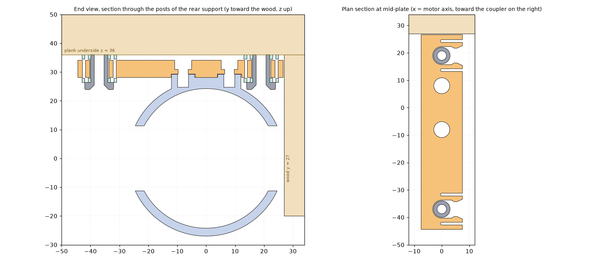

# Slide-in motor supports with silent blocks

Two printed supports that slide along the motor axis onto four fixed plots under the plank and lock by themselves (snap clip **sample 4**:
tongue 1.5 mm, interference 0.30 mm per side), **plus the two elastic elements that isolate the vibration**:

* **mount path** (drill body → wood): two TPU cushions around the plate on every plot (8 in total), the silent blocks of this version;
* **shaft path** (drill → desk axis): the jaw coupling with its TPU spider, carried over from the previous prototype. On the drill side, the drill
  adapter and hub A are now **one printed part, the drill hub** (no more screws or inserts between them); hub B is on the desk shaft.



The full report is `docs/slide_mount_assembly_report.pdf` (18 pages, A4 landscape): dimensioned plans, silent blocks, vibration estimate,
plank layout, assembly pictures, bill of materials, coupling and drill hub, validation plan and open items.

## Folder layout

| Folder | Content |
|---|---|
| `source/` | CadQuery scripts: every part, figure and the report are generated from them (see [Rebuild](#rebuild)) |
| `stl/` | generated meshes, ready to slice (`*_x2`, `*_x4`, `*_x8` = the full print plate) |
| `step/` | generated STEP models, check assemblies and the DXF profile of the clip |
| `docs/` | generated report (PDF), figures, and the assembly pictures in `docs/img/` |
| `solidworks/` | the drill hub, made in SolidWorks (not generated): assembly `DrillAdapter+hub.SLDASM` of `drillAdapterV4.SLDPRT` and `hub_a_drill_side.SLDPRT` (imported from `step/hub_a_drill_side.step`), and `DrillAdapter+hub.STL` to print |

## Parts

**Full bill of materials in [BOM.md](BOM.md)**: printed parts with their print settings and filament, screws and inserts, the bought
coupler, the reused parts and the tools.

In short: 2 clip plates, 4 plots, 2 ring supports, the drill hub and hub B in PETG; 8 cushions and the spider (+1 spare) in TPU 85A;
8 heat-set inserts M3 x 4 x OD4.2, 8 M3 cap screws (x 5, x 6), 4 wood screws dia 3 x 25 and one rigid flange coupler bore 6.35. No washers.
Check assemblies and the coupler model: `step/assembly_check.step`, `step/assembly_coupler*.step`, `step/flange_coupler_6.35mm.step`.

## Stack (desk frame: x = motor axis toward the coupler, y toward the vertical wood, z up, origin on the axis)

| | z |
|---|---|
| plank underside | 36.0 |
| top cushion | 36.0 to 34.5 (against the plank) |
| play | 0.3 |
| plate top / bottom | 34.2 / 28.2 |
| play | 0.3 |
| bottom cushion | 27.9 to 26.4 (on the plot head) |
| plot head | 26.4 to 23.9 |
| ring top / pad top (bearing face of the plate) | 27.0 / 28.2 |

Plots at **y = -37** (ear side) and **y = +19** (wood side), pitch 56. Plate from y = -44.4 to +26.6. Ring relief flat at y = 26.

## Rings and detrompeurs (read in your SolidWorks files)

The two rings are taken from `motor_mount_1.SLDPRT` and `motor_front_mount_1.SLDPRT`; every vertex of your parts that lies on the ring is within
0.002 mm of the rebuilt ring (`source/sldprt_reader/compare_rings.py` repeats the check on your files).

* **motor_mount** (bore 48.5, x = 0 to 15): closed rim for x 0 to 3; side slots for x 3 to 6 (|z| < 4.25); side windows for x 6 to 15 (|z| < 11.3), on both sides;
  relief flat at y = 26 (|z| < 7.3) on the wood side. Printed with the x = 0 rim on the bed.
* **motor_front_mount** (bore 48, width 12): four slots at 45 degrees with a flat bottom 26.0 from the axis, three 4.4 wide and one **6.2 wide, the key**;
  flat at y = 26. Drawn in the desk frame (wood on +y, end view from the coupler side): in your file, mirrored, the wide slot is at 225 degrees; here it is at
  315 degrees, **bottom right**, as you confirmed. `FRONT_KEY_ANGLE` in `build_slide_mount.py` moves it.
* Not reproduced: ear, blade, gussets, fillets and the holes of the ear and blade (the pad replaces them).

## Assembly

1. Press the 4 M3 x 4 inserts into the bosses of the pads, flush. 2. Screw each plate on its pad: its recesses fit on the bosses (2 x M3 x 5,
mouths toward the coupler, 0.3 N.m at most).
3. Slide 2 cushions on the shoulder of every plot: one down to the head, one up to the flat top (friction fit). 4. Drill the plank through the drilling
jig (next section) and screw the 4 plots, flat top fully against the plank. 5. Slide the motor, rings and plates on, toward the coupler: each plot spreads the tongues, the
clip snaps behind it, the slot end stops the motor and the coupling jaws engage. 6. Turn the axis by hand: no tight spot, axis offset at most 0.3 mm.
7. To remove the motor, pull it back along its axis. Pictures on page 12 of the report.

## Drilling jig

`stl/drill_jig.stl` puts the four pilot holes at the plot positions: rows 58.0 apart (the rings are 44.5 apart edge to edge, `RING_GAP` in
`source/build_slide_mount.py`), holes 8 and 64 mm from the vertical wood face. A bare frame, about 3 g of PETG: print it flat, the plank face on
the bed, no support.

1. Ream each guide once with the dia 2.0-2.2 bit. 2. Plates on the rings, coupling fully engaged (motor pushed toward the coupler): mark the two
edges of each plate on the vertical wood face. 3. Hold the jig flat on the plank, its two lips against the wood face, the lip ends on the marks (each
lip is as wide as a plate). Both lips must match their marks: that checks the spacing. 4. Drill through the guides with the depth stop at 22 mm from
the tip of the bit (8 of guide + 14 in the wood).

## Silent blocks (TPU cushions)

* The plate floats between the two cushions with **0.3 mm of play on each side**: no preload, so no friction when sliding in; under torque or weight
  it meets a cushion, never PETG on wood.
* **Set the thickness for your desk.** With H the real distance from the shaft axis to the plank underside (36.0 assumed) and d = H - 36: top cushion
  1.5 + d, bottom cushion 1.5 - d (layers of 0.2). Or change `PLANK_Z` in `source/build_slide_mount.py`: pad, plate height and plots are recomputed.
* Stiffness estimate (TPU 85A, E about 12 MPa assumed): wheel about 610 N/mm, natural frequency about 450 Hz, isolation above about 640 Hz;
  the solid washer sits on a resonance near 1 kHz. **These are estimates: measure with the ADXL345** and tune by printing 3 sets at 2 / 3 / 4 walls.
* With equal plays the posts share the couple unevenly (about 36 N at A, 17 N at B at 1.65 N.m); the difference goes radially through the coupling
  (axis shift about 0.1 mm, estimate). Smaller plays (`GAP`) reduce it.

## Putting the clip in your own SolidWorks supports

* `step/clip_sample4_profile.dxf`: outline of one clip, **origin on the plot axis, mouth toward +x**. Open it as a 2D sketch, copy it into a sketch on
  your plate, Cut-Extrude through 6 mm. `step/clip_cut_tool.step` is the same as a solid (Combine > Subtract). Dimensions in
  `docs/clip_sample4_drawing.png` and on page 17 of the report.
* Print the plate **flat**: the tongues bend in the plane of the layers (a tongue printed across the layers would crack).

## Open items

* Axial spacing: 58.0 between the ring centres, from the 44.5 measured between the rings. The drilling jig checks it against the plates before drilling.
* Mouth direction (+x assumed toward the coupler), the direction of the rear ring along x (as in your file), the key of the front ring against your drill, plank thickness.
* **Axial float**: with clip sample 4 a plot can move about 3.7 mm between the slot end and the lugs; the coupling jaws (7 mm) accept it.
* Extraction force about 4 x 53 N = 210 N by beam theory: measure; sample 3 is the fallback.
* Checked in CAD only (watertight STL, no interference except the designed friction fit of the cushions). Nothing has been printed yet.

## Rebuild

```
pip install -r source/requirements.txt
python source/build_slide_mount.py         # supports, plots, cushions, clip files, check assembly
python source/coupling/build_coupling.py   # hub B, spider, flange coupler, hub A (STEP only, for the drill hub), check assemblies
python source/build_drill_jig.py           # drilling jig (rows AXIAL_SPACING apart)
python source/make_figures.py && python source/steps_images.py
python source/sldprt_reader/compare_rings.py motor_mount.SLDPRT motor_front_mount.SLDPRT   # check the rings against your files
python source/report/build_report.py       # the PDF report
```
